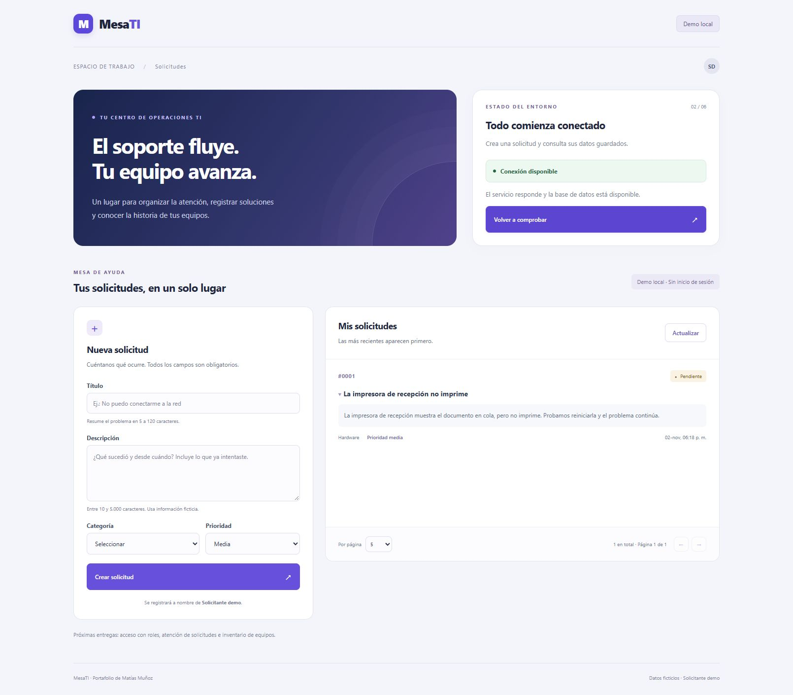

# MesaTI · Mesa de ayuda TI

Aplicación full stack para registrar y consultar solicitudes de soporte TI. Construida con **React, TypeScript, Node.js, Express y PostgreSQL**, con un inventario básico de equipos previsto para una próxima etapa.

**Estado:** etapa 2 implementada localmente. Puedes crear tickets y consultar el listado paginado con PostgreSQL real. Se utiliza un solicitante ficticio, sin inicio de sesión. Todavía no hay roles autenticados, atención de tickets ni despliegue.



## Qué funciona hoy

- Formulario para crear tickets con título, descripción, categoría y prioridad.
- Validación en el servidor: límites de texto, valores permitidos y rechazo de campos reservados.
- Guardado del ticket y su evento de creación en una sola transacción de PostgreSQL.
- Listado paginado con total real, orden estable y descripción desplegable.
- Estados de carga, vacío, confirmación y error; el formulario conserva los datos si falla el envío.
- Comprobación de disponibilidad de la base y recuperación después de reiniciarla.
- Diseño adaptable a escritorio y móvil, etiquetas de formulario y foco en el campo inválido.

La persistencia se comprobó creando una solicitud desde la interfaz y reiniciando API, interfaz y PostgreSQL: el ticket y su evento se conservaron. [Ver pruebas y evidencia](docs/07-primer-ticket.md).

## Propósito

Organizar un problema habitual de soporte: registrar una falla, identificar a quien solicita ayuda y conservar el seguimiento. Es un proyecto personal de aprendizaje y portafolio de Matías Muñoz Saavedra, desarrollado por etapas con requisitos, decisiones, pruebas y commits documentados.

El objetivo del MVP es completar el recorrido: un solicitante informa una falla, un técnico la toma, registra su diagnóstico y la resuelve; el historial y los indicadores reflejan los cambios persistidos. Actualmente está implementado el registro y la consulta inicial.

## Próximas etapas

| Etapa                                                   | Estado                    |
| ------------------------------------------------------- | ------------------------- |
| Entorno y conexión a PostgreSQL                         | Implementada y verificada |
| Crear y listar tickets                                  | Implementada y verificada |
| Inicio de sesión, cuentas y permisos                    | Próximo trabajo           |
| Asignación, resolución, comentarios e historial visible | Pendiente                 |
| Inventario, filtros e indicadores                       | Pendiente                 |
| Preparación de demostración y despliegue                | Pendiente                 |

La implementación se retoma con **autenticación y autorización**: cuentas de solicitante y técnico, sesiones e impedimento de acceso a tickets ajenos. [Plan completo](docs/04-plan.md).

## Documentación

- [Alcance, usuarios y reglas](docs/01-producto.md).
- [Arquitectura y decisiones iniciales](docs/02-arquitectura.md).
- [Modelo de datos y contrato de API propuesto](docs/03-datos-api.md).
- [Plan de entregas y aprendizaje](docs/04-plan.md).
- [Guía de contribución, commits y calidad](CONTRIBUTING.md).
- [Instalación local, verificaciones y guía de aprendizaje](docs/05-entorno-local.md).
- [Primer ticket: modelo, API, pruebas y aprendizaje](docs/07-primer-ticket.md).

## Tecnologías y herramientas

| Área         | Elección                       | Propósito                                       |
| ------------ | ------------------------------ | ----------------------------------------------- |
| Interfaz     | React + TypeScript             | Formularios y navegación con tipos explícitos   |
| API          | Node.js + Express + TypeScript | Entender HTTP, validaciones y reglas de negocio |
| Persistencia | PostgreSQL                     | Relaciones, SQL, transacciones y consultas      |
| Pruebas      | Vitest + Supertest             | Comprobar lógica y comportamiento HTTP          |
| Versionado   | Git                            | Cambios pequeños y trazables                    |

Vite ejecuta y compila la interfaz. `pg` conecta la API con PostgreSQL mediante SQL parametrizado. Docker Compose administra la base local; ESLint, Prettier y TypeScript estricto comprueban la calidad del código.

Las versiones exactas están fijadas en los archivos `package.json` y `package-lock.json`. El entorno usa Node.js 24 y PostgreSQL 17 mediante Docker Compose.

## Organización

```text
apps/web/src/tickets/       Formulario, listado y consumo de la API
apps/api/src/modules/      Validaciones, rutas y consultas de tickets
apps/api/src/db/           Conexión, migraciones y datos demo
apps/api/migrations/       Estructura SQL versionada
apps/api/tests/            Pruebas unitarias y de integración
docs/                     Producto, arquitectura, planificación y evidencias
```

El navegador se comunica con la API REST; la API valida y consulta PostgreSQL. Los datos de conexión permanecen en el servidor. El solicitante temporal se determina en el backend y no se acepta desde el formulario.

## Ejecutar localmente

Requisitos: Node.js 24, npm y Docker Desktop iniciado con motor Linux. Desde la raíz del repositorio, en PowerShell:

```powershell
git clone https://github.com/Matias-dev-cl/mesati.git
cd mesati
npm.cmd ci
# Solo la primera vez, si no existe .env:
Copy-Item .env.example .env
npm.cmd run db:up
npm.cmd run db:prepare
```

El archivo `.env` debe incluir `LOCAL_DEMO_ENABLED=true` para esta etapa. Si ya existía antes de la etapa 2, agregar esa línea y reiniciar la API. Este modo es exclusivamente local y no puede habilitarse con `NODE_ENV=production`.

Abrir dos terminales en la misma carpeta:

```powershell
# Terminal 1
npm.cmd run dev:api
```

```powershell
# Terminal 2
npm.cmd run dev:web
```

Abrir [MesaTI local](http://127.0.0.1:5173/). La API está en `http://127.0.0.1:3001/api/v1/health`. Sin PostgreSQL disponible, devuelve 503 y la pantalla indica conexión no disponible. La guía del entorno conserva el diagnóstico inicial; el problema de Docker quedó resuelto y documentado en [la resolución](docs/06-docker-resuelto.md).

En otros sistemas se puede usar `npm` en lugar de `npm.cmd` y copiar el ejemplo de entorno con la herramienta correspondiente. No se han verificado todavía esos sistemas.

## Verificación

```powershell
npm.cmd run check
npm.cmd run test:integration
```

`check` ejecuta formato, análisis estático, tipos, 11 pruebas unitarias y compilación. `test:integration` ejecuta 26 pruebas HTTP y de persistencia contra una base temporal de PostgreSQL, creada y eliminada por la suite sin vaciar los datos de desarrollo. Requiere Docker funcionando y el usuario local con permiso para crear bases. El código compilado aún no incluye una configuración de despliegue para servir interfaz y API juntas.

El [workflow de GitHub Actions](.github/workflows/ci.yml) ejecuta estos mismos controles con PostgreSQL en cada cambio a `main`, las ramas `codex/` y las solicitudes de incorporación. Los datos y credenciales del servicio de pruebas son ficticios y exclusivos del entorno descartable de CI.

## Qué se podrá demostrar al terminar

- Recorrido completo con dos roles, datos ficticios y permisos verificables.
- Instrucciones de instalación desde un clon limpio, migraciones y carga de datos demo.
- Pruebas de reglas importantes y evidencias de depuración y rendimiento.
- Capturas y decisiones documentadas, con limitaciones conocidas.

Un proyecto personal no acredita experiencia laboral en equipo. El README final distinguirá lo implementado, lo practicado y lo pendiente.

## Cómo trabajar en este proyecto

Consultar primero [el plan](docs/04-plan.md) y [la guía de contribución](CONTRIBUTING.md). Antes de implementar una entrega, identificar su problema, criterios de aceptación, forma de verificarla y conceptos que se deben comprender.

El siguiente paso es repasar cómo viaja un ticket del formulario a PostgreSQL. Después se implementarán sesiones y permisos, retirando la identidad demo temporal. Este repositorio publica el código y su avance; no hay una aplicación desplegada para uso público.
