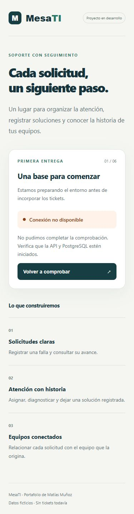

# Entrega 1: entorno mínimo

## Objetivo y criterios de aceptación

Comprobar el recorrido navegador → API → PostgreSQL antes de construir tickets.

- La interfaz React consulta `/api/v1/health` y muestra carga, conexión correcta o indisponibilidad.
- La API ejecuta `SELECT 1`; responde 200 si la base contesta y 503 si falla, sin exponer credenciales ni errores internos.
- Una ruta desconocida devuelve 404 en JSON.
- PostgreSQL se ejecuta aislado en Docker, con puerto ligado solo a la máquina local y volumen persistente.
- Existen controles de formato, análisis estático, tipos, pruebas HTTP y compilación.

## Herramientas y fuentes

Se utiliza Node.js 24 (instalado: 24.19.0), npm workspaces y TypeScript estricto. Las versiones exactas de dependencias quedan registradas en `package-lock.json`; usar `npm ci` para reproducirlas.

Fuentes consultadas al iniciar esta entrega:

- [Ciclo de soporte de Node.js](https://nodejs.org/en/about/previous-releases).
- [Requisitos y funcionamiento de Vite](https://vite.dev/guide/).
- [Instalación de Express](https://expressjs.com/en/starter/installing/).
- [Soporte de PostgreSQL](https://www.postgresql.org/support/versioning/).

## Preparación y arranque

Ejecutar desde la raíz del repositorio en PowerShell. No sobrescribir un `.env` que ya tenga configuración propia.

```powershell
npm.cmd ci
Copy-Item .env.example .env
npm.cmd run db:up
```

`npm ci` instala las versiones del lockfile. Compose lee `.env`, inicia PostgreSQL 17 y espera que su comprobación de disponibilidad sea correcta. Se utiliza la etiqueta `postgres:17-alpine`, que puede recibir actualizaciones menores: el digest de la imagen se registrará cuando se consiga descargar y probar. No se considera todavía un entorno de base validado.

El puerto de PostgreSQL en esta máquina es 5434; el puerto dentro del contenedor es 5432. El nombre del volumen lo administra Compose para este proyecto. `.env` está excluido de Git y los valores de `.env.example` son ficticios, solo para uso local.

En dos terminales separadas, siempre desde la raíz:

```powershell
npm.cmd run dev:api
```

```powershell
npm.cmd run dev:web
```

Abrir `http://127.0.0.1:5173/`. Ambas aplicaciones escuchan solo en la máquina local. Si se cambia `API_PORT` en `.env`, reiniciar ambos procesos.

Vite recibe `/api` en el puerto 5173 y lo reenvía a Express en el 3001. Así el navegador utiliza un solo origen durante el desarrollo. Ese proxy no se incorpora a los archivos compilados de producción; el despliegue se diseñará más adelante.

Para detener interfaz y API, usar Ctrl+C en sus terminales. Para detener la base sin borrar sus datos:

```powershell
npm.cmd run db:stop
```

## Verificaciones disponibles

```powershell
npm.cmd run check
docker compose config --quiet
Invoke-WebRequest http://127.0.0.1:3001/api/v1/health -SkipHttpErrorCheck
Invoke-WebRequest http://127.0.0.1:5173/api/v1/health -SkipHttpErrorCheck
```

`-SkipHttpErrorCheck` requiere PowerShell 7; en otro cliente HTTP basta con inspeccionar el código y el JSON. Las pruebas de Vitest usan una función de consulta simulada: prueban las respuestas HTTP y la configuración, sin tocar una base.

### Evidencia obtenida el 2 de noviembre de 2026

| Comprobación                    | Resultado                                                                   |
| ------------------------------- | --------------------------------------------------------------------------- |
| Instalación de dependencias     | Completada con Node 24.19.0 y npm 11.17.0                                   |
| Formato, ESLint y TypeScript    | Correctos                                                                   |
| Pruebas automatizadas           | 10 aprobadas en 2 archivos                                                  |
| Compilación API y React         | Correcta                                                                    |
| Sintaxis de Compose             | Válida                                                                      |
| API real, puerto 3001           | 503 con `database: down`                                                    |
| API mediante Vite, puerto 5173  | El mismo 503 y JSON                                                         |
| Pantalla y botón de reintento   | Muestran indisponibilidad y permiten volver a consultar                     |
| Revisión visual                 | Escritorio y ancho móvil de 390 px, sin desbordamiento horizontal observado |
| PostgreSQL real y respuesta 200 | Pendientes; Docker no inicia                                                |

La captura muestra el estado real de esta entrega, con la base no disponible:



## Bloqueo del equipo y siguiente comprobación

Docker Desktop falla antes de iniciar el motor Linux. Sus registros indican `The file cannot be accessed by the system` al abrir sockets locales como `sailor-ingest.sock` y `engine.sock`. No se ha demostrado una causa definitiva.

Se intentó un reinicio con respaldo de los directorios temporales de comunicación. El problema reapareció; se restauraron los directorios originales y se detuvieron los procesos de Docker iniciados durante la comprobación. No se borraron volúmenes, distribuciones WSL ni bases existentes. No se ejecutó un restablecimiento de fábrica.

La etapa permanece en curso. Antes de continuar con tickets:

1. Conseguir que `docker version` muestre cliente y servidor; revisar el fallo local de Docker si persiste.
2. Ejecutar `npm.cmd run db:up` y comprobar `docker compose ps`.
3. Consultar `/api/v1/health`: debe devolver 200 y `database: up`.
4. Pulsar «Volver a comprobar»: la pantalla debe mostrar conexión disponible.
5. Detener la base con `npm.cmd run db:stop`, comprobar 503, volver a iniciarla y verificar recuperación.
6. Registrar estos resultados reales, sin sustituir PostgreSQL por una respuesta simulada.

## Repaso de aprendizaje para Maty

- **React** construye lo que ves. El botón vuelve a enviar una petición; no conecta directamente a PostgreSQL.
- **Express** recibe esa petición HTTP y usa el pool para ejecutar `SELECT 1`.
- **PostgreSQL** será quien guarde los tickets en la etapa siguiente. Aquí solo se comprueba si puede responder.
- **200** significa que la comprobación terminó bien; **503** indica que una dependencia necesaria no está disponible.
- **Pool** es un grupo limitado de conexiones reutilizables; evita abrir una conexión nueva sin control por cada petición.

Primera práctica: abrir la pantalla, pulsar «Volver a comprobar» y explicar qué componente recibe la petición y por qué aparece indisponibilidad aunque React y Express estén ejecutándose. La comprensión aún no se ha evaluado; revisarla con Maty antes de ampliar el producto.
