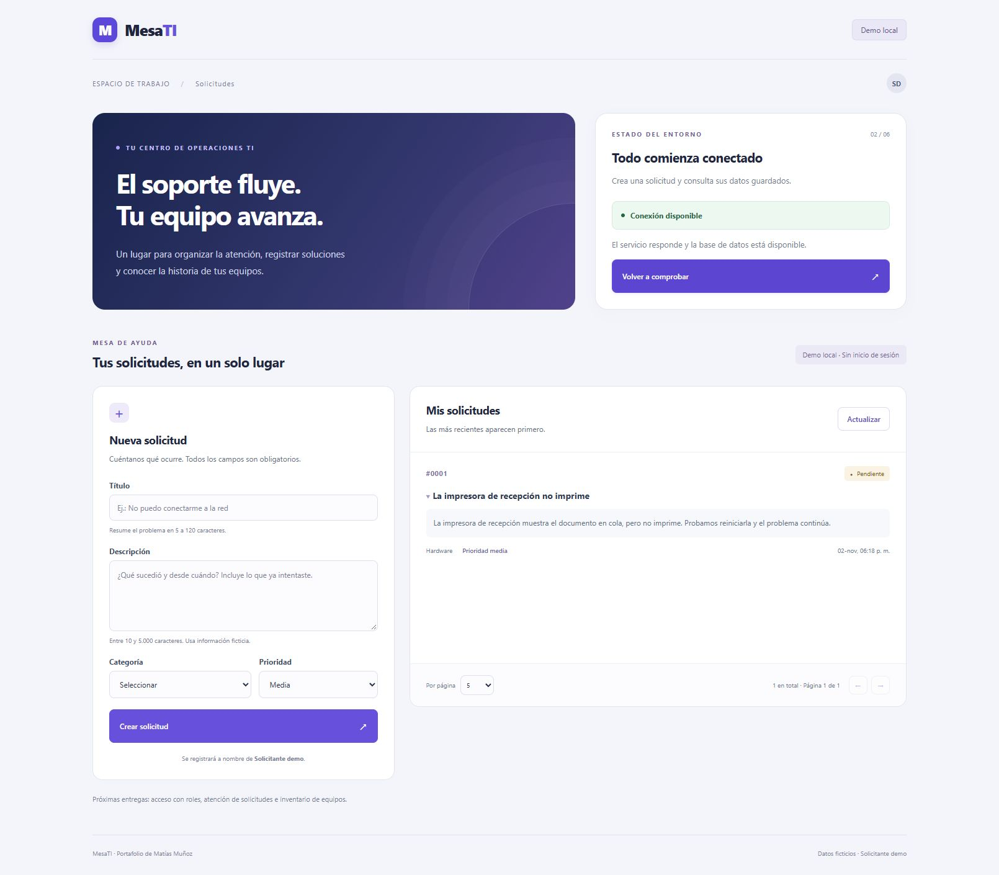

# Etapa 2 — Crear y listar tickets

## Alcance y aceptación

Esta entrega conecta formulario, API y PostgreSQL. Usa un solicitante ficticio local, sin login. El inventario, los filtros avanzados, las transiciones y los comentarios pertenecen a entregas posteriores.

- Crear con título de 5–120 caracteres y descripción de 10–5.000, después de recortar espacios; categoría y prioridad deben pertenecer al catálogo.
- Rechazar campos adicionales, incluidos estado, solicitante, técnico, equipo y fechas.
- Guardar ticket pendiente y evento de creación en una misma transacción.
- Listar solo tickets del solicitante demo, ordenados por fecha e identificador descendente, con paginación y total real.
- Mostrar vacío, carga, errores y confirmación; conservar el formulario si falla el envío.
- Conservar la solicitud después de reiniciar los procesos y la base.

## Modelo de esta entrega

| Tabla               | Responsabilidad                                                                            |
| ------------------- | ------------------------------------------------------------------------------------------ |
| `users`             | Identidad ficticia referenciada por solicitante y actor. Sin contraseñas ni login todavía. |
| `tickets`           | Problema, clasificación, solicitante, estado y fechas.                                     |
| `ticket_events`     | Registro inmutable desde la API de quién creó cada solicitud y cuándo.                     |
| `schema_migrations` | Archivos SQL aplicados y su huella para detectar modificaciones posteriores.               |

Las claves foráneas impiden referencias a usuarios o tickets inexistentes. Las restricciones de la base complementan las validaciones HTTP. El índice del listado sigue su filtro por solicitante y su orden estable; la medición de rendimiento sigue pendiente.

La migración es una receta versionada para crear la estructura. Ejecutar la preparación varias veces no duplica tablas ni el usuario demo. No modificar una migración aplicada: agregar otra para el próximo cambio.

```powershell
npm.cmd run db:up
npm.cmd run db:prepare
```

El seed agrega únicamente `Solicitante demo` con dirección ficticia `solicitante@mesati.invalid`; no fabrica tickets ni métricas.

## Contrato acordado

`POST /api/v1/tickets`, cuerpo JSON con exactamente `title`, `description`, `category`, `priority`. Respuesta 201: `{ data: ticket }`. El servidor decide solicitante, estado y fechas.

`GET /api/v1/tickets?page=1&pageSize=20`. Página positiva hasta 1.000.000, tamaño de 1 a 100. Respuesta `{ data: ticket[], pagination: { page, pageSize, total } }`. Una página posterior a la última devuelve lista vacía y conserva el total.

Cada ticket contiene `id`, `title`, `description`, `category`, `priority`, `status`, `requesterId`, `createdAt`, `updatedAt`. Las fechas se serializan como ISO 8601. El historial se guarda en la base; su interfaz llegará con la etapa 4.

Errores previstos: 400 entrada inválida, 413 cuerpo demasiado grande, 415 formato distinto de JSON, 503 servicio no disponible y 500 error interno sin detalles sensibles. Se conserva el formato `{ error: { code, message, fields? } }`.

## Condición temporal de acceso

La API solo habilitará tickets con `LOCAL_DEMO_ENABLED=true`, rechazado en producción. Los servidores siguen ligados a `127.0.0.1`; no publicar esta versión. El solicitante se busca por la dirección fija del seed, nunca por un valor del navegador. Esto no sustituye autenticación: se retirará al implementar sesiones.

## Fuentes de implementación

- [Transacciones con un mismo cliente PostgreSQL](https://node-postgres.com/features/transactions).
- [Consultas parametrizadas](https://node-postgres.com/features/queries).
- [Errores asíncronos de Express](https://expressjs.com/en/guide/error-handling/).

Las verificaciones y evidencias se registrarán al completar cada parte.

## Verificación de la base

Preparación ejecutada dos veces: la primera aplicó una migración y la segunda ninguna. PostgreSQL confirmó un único usuario demo y cero tickets. TypeScript verificó los nuevos módulos sin errores.

## Verificación de la API

Aprobadas 11 pruebas unitarias y 26 pruebas de integración con PostgreSQL real en una base temporal aislada, eliminada al finalizar. Se comprobaron entradas inválidas, campos reservados, límites, SQL tratado como texto, paginación, alcance del solicitante, formatos HTTP y rollback si falla el evento. También pasaron lint y TypeScript.

Ejecutar integración con npm run test:integration. El usuario local de PostgreSQL necesita permiso para crear una base temporal; la prueba genera su propio nombre mesati_test más UUID y nunca vacía la base de desarrollo.

## Verificación de la interfaz y persistencia

- Lista inicialmente vacía; creación desde el navegador del ticket #1 «La impresora de recepción no imprime».
- Título compuesto solo de espacios rechazado: error asociado y foco en el campo, conservando los otros datos.
- PostgreSQL detenido: error de envío y de listado, sin borrar el formulario.
- PostgreSQL restaurado: envío exitoso, formulario limpio y listado actualizado con un registro real.
- Descripción consultable al desplegar el título de la solicitud.
- API, Vite y PostgreSQL detenidos y reiniciados: el ticket #1 sigue en el listado y conserva un evento de creación en la base.
- Revisión en escritorio y móvil de 390 px, sin desbordamiento horizontal observado; selector de tamaño de página comprobado.

Las pruebas manuales dejan un ticket ficticio útil para la demostración. Las 26 pruebas automatizadas usan una base independiente y no añaden datos a esta demo.



## Ejercicio de comprensión

1. Abrir MesaTI y registrar una solicitud ficticia diferente.
2. Explicar por qué el servidor decide el solicitante y el estado aunque el formulario no los incluya.
3. Identificar qué tabla guarda el problema y cuál registra su creación.
4. Explicar por qué ticket y evento deben guardarse dentro de la misma transacción.
5. Recargar la página y explicar por qué el ticket sigue ahí aunque el estado de React se haya reiniciado.

Los endpoints de atención, login, equipos y comentarios aún no están implementados. Si se pierde la conexión durante un envío, revisar el listado antes de reenviar: esta versión bloquea el doble clic, pero todavía no implementa claves de idempotencia para reintentos después de una respuesta perdida.
